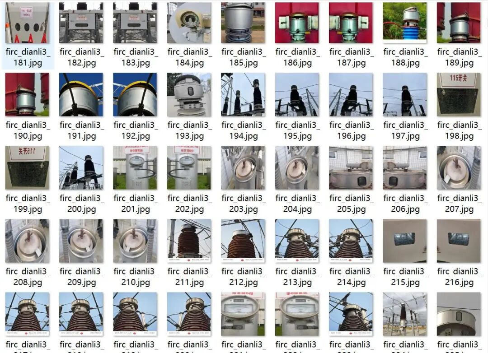
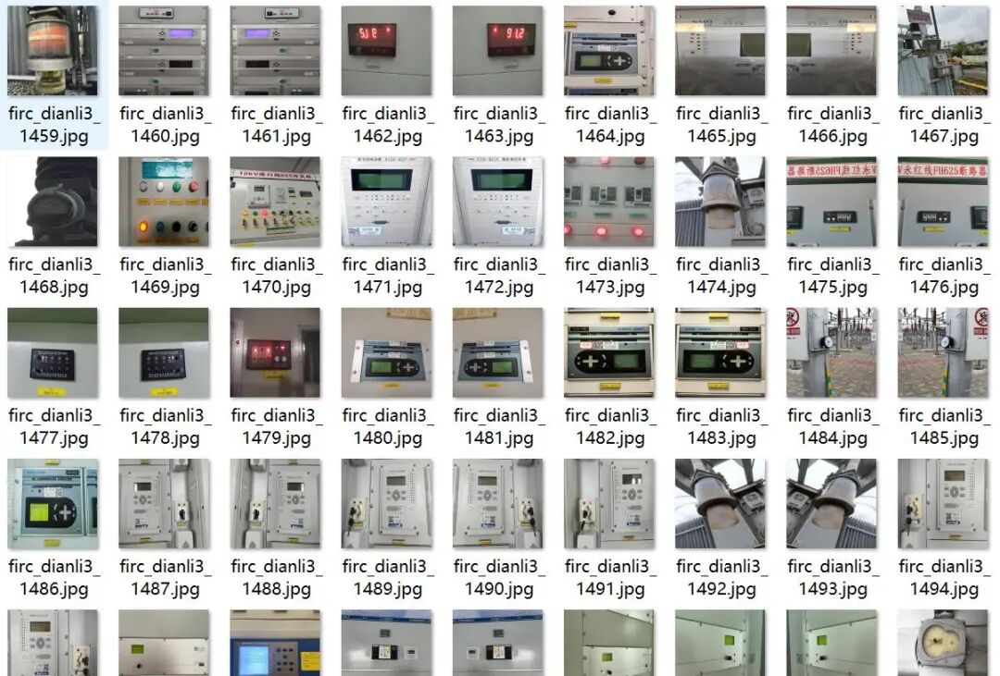
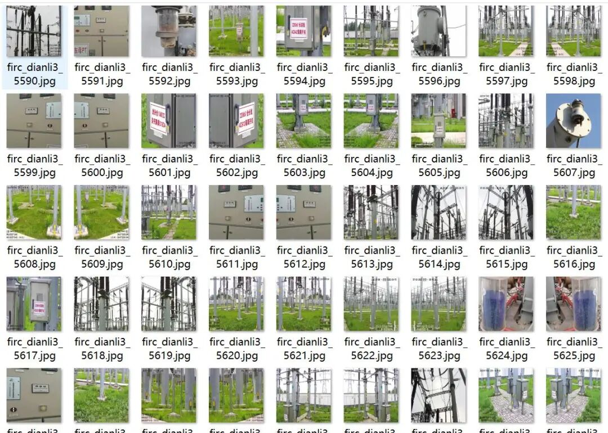
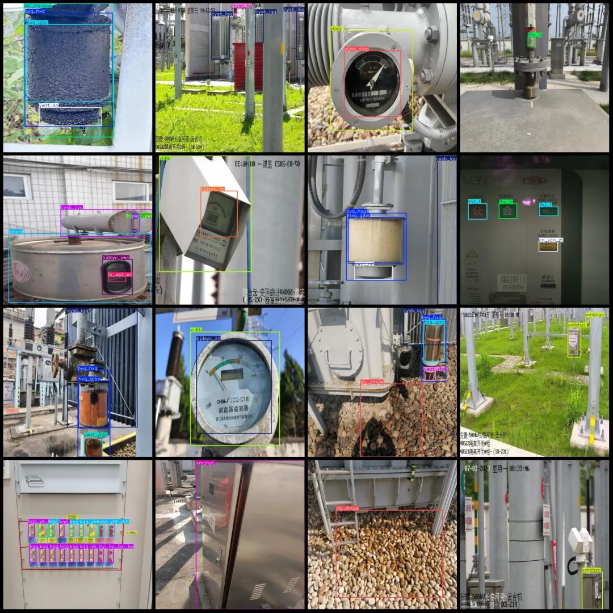

# Power Scene Substation Defect Detection Dataset VOC+YOLO Format: 8116 Images, 78 Categories

Half of the dataset contains enhanced images, with most enhancement methods being flipping.

Dataset format: Pascal VOC format + YOLO format (txt file without split path, only containing jpg images and corresponding VOC format xml files and yolo format txt files)

Number of images (number of jpg files): 8116

Number of annotations (number of xml files): 8116

Number of annotations (number of txt files): 8116

Label count: 78

The following are the product technical requirements:

Number of boxes labeled in each category:

SF6ylb frame count = 186

aqmzc Frame Count = 4

bj_bpmh Frame Count = 397

bj_bpps frame count = 272

bj_sx Frame Count = 82

bj_wkps = 179

bjdsyc_sx Frame Count = 32

bjdsyc_ywc Frame Count = 79

bjdsyc_ywj Frame count = 63

bjdsyc_zz Frame Count = 175

bjdszc_sx Frame Count = 104

bjdszc_tx_wyt frame count = 240

bjdszc_tx_yyt Frame Count = 72

bjdszc_yx_yyt Frames = 34

bjdszc_zz Frame Count = 949

Bmwh Frame Count = 383

byq_hxq frame count = 730

cn_wcn_zz Frame Count = 1

cn_ycn_zt Frames = 7

cn_ycn_zz = 151

cysb_cyg Frame Count = 682

cysb_lqq frame count = 1241

cysb_qtjdq = 178

cysb_qyb frame count = 42

cysb_sgz frame count = 267

cysb_tg frame count = 1051

fhz_f = 198

fhz_h = 421

fhz_ztyc = 119

gcc_mh box number = 228

gcc_ps = 89

gcc_zc box number = 59

gzzc box count = 9

Hand frame count = 8

hxq_gjbs Frame Count = 437

hxq_gjtps Frame Count = 35

hxq_gjzc Frames = 185

hxq_yfps frame count = 97

jsxs_ecjxh box count = 1

jyh Frames = 8

jyz_pl = 153

kgg_yb_by Frames = 1005

kgg_ybf frame count = 899

kgg_ybh frame count = 1657

kk_f = 425

kk_h = 906

pzqcd frame count = 184

pzqzc Frame Count = 1419

qt_bj = 156

sly_bjbmyw = 163

sly_dmyw = 239

tx_wyt = 296

tx_wyt_wz = 144

tx_yyt Frame Count = 124

tx_yyt_wz = 63

wcaqm Frame Count = 4

ws_ywyc = 70

ws_ywzc Frame Count = 87

xldlb frame count = 452

xmbhyc Frame Count = 263

xmbhzc Frame Count = 5718

YLB Frame Count = 136

yljdq Frames = 108

yljdq_flow Frame Count = 23

yljdq_stop = 85

Number of YLSFF frames = 16

yw_gkxfw = 155

yw_nc = 108

ywb box count = 237

ywc frame count = 340

ywj Frames = 216

ywzt_no = 352

ywzt_yfyc Frame Count = 197

ywzt_yfzc Frame count = 62

yx_yyt = 49

yx_yyt_wz = 24

zsd_l = 631

zsd_m = 2486

Total frame count: 29147

Using labelImg:

Annotation rules: Draw a rectangle around the category.

Important Notice: No

Image resolution: 640x640

Special : This dataset does not guarantee the accuracy of the trained models or weight files.

{

"SF6ylb": "SF6 pressure gauge"

"aqmzc": "Safety helmet is normal."

"bj_bpmh": "The dial of the meter is blurred."

"bj_bpps": "The dial of the meter is damaged."

"bj_sx": "meter rusting"

"bj_wkps": "The meter case is damaged."

"bjdsyc_sx": "Meter Reading Abnormality - Rust"

"bjdsyc_ywc": "Meter Reading Abnormality - Error"

"bjdsyc_ywj": "Meter Reading Abnormality - Dirty Marks"

"bjdsyc_zz": "Meter Reading Abnormality - Stained"

"bjdszc_sx": "The reading of the meter is normal - rusted."

"bjdszc_tx_wyt": "The meter reading is normal - there is no oil stains in the image."

"bjdszc_tx_yyt": "The meter reading is normal, but there is oil stains in the image."

"bjdszc_yx_yyt": "The readings of the meter are normal, but there is oil stain in the image."

"bjdszc_zz": "The readings of the meter are normal - dirty spots."

"bmwh": "The dashboard is dirty."

"byq_hxq": "Transformer breather"

"cn_wcn_zz": "Ceramic Inside, No-Dust Internal - Stains"

"cn_ycn_zt": "Ceramic internal dust state"

"cn_ycn_zz": "Ceramic internal dust and stains"

"cysb_cyg": "Test equipment - Tester"

"cysb_lqq": "Test Equipment - Flow Meter"

"cysb_qtjdq": "Test equipment - Other Relays"

"cysb_qyb": "Test equipment - Pressure Gauge"

"cysb_sgz": "Test equipment - dynamometer"

"cysb_tg": "Test Equipment - Probe Tube"

"fhz_f": "Separator/Closer - Seperate"

"fhz_h": "Close-Open_Close"

"fhz_ztyc": "Separation and Closure Status Abnormal"

"gcc_mh": "Observation window blurry"

"gcc_ps": "Observe the window is damaged."

"gcc_zc": "The observation window is normal."

"gzzc": "Works normally"

"hand": "Hand"

"hxq_gjbs": "Respirator silicone color change"

"hxq_gjtps": "Respirator silicone body rupture"

"hxq_gjzc": "Respirator silicone is normal."

"hxq_yfps": "Respirator seal damaged"

"jsxs_ecjxh": "Mechanical Damage - Secondary Junction Box"

"jyh": "insulation"

"jyz_pl": "insulator crack"

"kgg_yb_by": "Switchgear instrument panel"

"kgg_ybf": "Switch cabinet instrument subdivision"

"kgg_ybh": "Switch cabinet instrument union"

"kk_f": "Opening_split"

"kk_h": "Opening and Closing"

"pzqcd": "Weight Balancer Damaged"

"pzqzc": "Weight balancer is normal."

"qt_bj": "Other meter instruments."

"sly_bjbmyw": "Leakage oil - surface oil stains on the meter."

"sly_dmyw": "Leakage oil - ground oil stains"

"tx_wyt": "Image free of oil stains."

"tx_wyt_wz": "Image without oil stains_Text"

"tx_yyt": "The image has oil stains."

"tx_yyt_wz": "Image has oil stains_text"

"wcaqm": "Not wearing a safety helmet."

"ws_ywyc": "Gas oil level anomaly"

"ws_ywzc": "Gas oil level is normal"

"xldlb": "Line current meter"

"xmbhyc": "The door of the box is abnormally closed."

"xmbhzc": "The door of the box is closed normally."

"ylb": "Pressure gauge"

"yljdq": "Pressure relay"

"yljdq_flow": "Pressure relay_Flow"

"yljdq_stop": "Pressure relay_stop"

"ylsff": "Pressure relief valve"

"yw_gkxfw": "Foreign Objects - Hanging Free Debris"

"yw_nc": "Foreign Objects - Nest"

"ywb": "Oil level gauge"

"ywc": "There is an error"

"ywj": "has stains"

"ywzt_no": "oil level status - no"

"ywzt_yfyc": "Oil Level Status - Abnormal"

"ywzt_yfzc": "Oil Level Status - Normal"

"yx_yyt": "The image has oil stains."

"yx_yyt_wz": "Image has oil stains_text"

"zsd_l": "Indicator light is on."

"zsd_m": "Indicator _ off"

}

Image Preview:

Annotation examples (randomly select 16 images to show the annotation situation):

## Payment

Here is a pay link on Stripe ( https://buy.stripe.com/3cs8yP7sY87d0vu9AB ). Please contact me lonlonago@foxmail.com after funding $89, and I will send you a complete data files , thank you!

